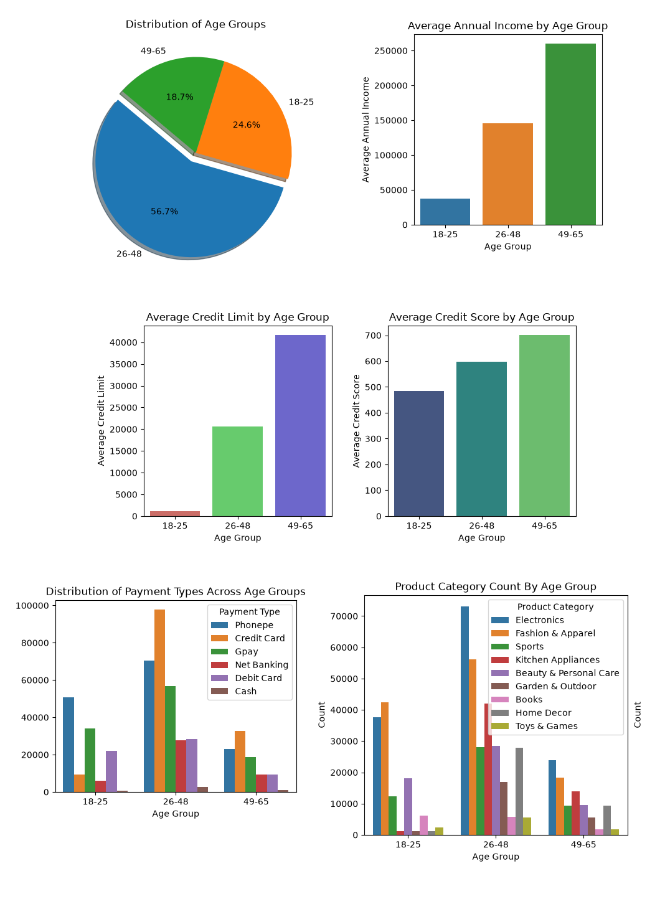
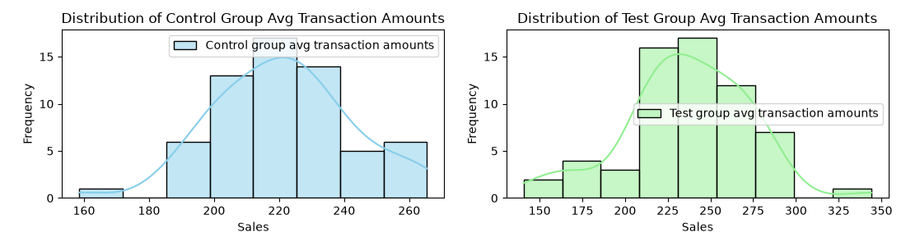

# Credit Card Launch Analysis

## Project Overview

This project focuses on analyzing customer data and evaluating the potential impact of a new credit card launch for a Bank. The main goal is to identify an underserved customer segment and determine whether introducing a new credit card can increase average transaction amounts.

The project combines exploratory data analysis (EDA), customer segmentation, and A/B testing to support data-driven business decisions.

## Problem Statement

A Bank plans to introduce a new credit card but needs to identify the most suitable target audience. The bank also wants to measure whether the new card leads to an increase in customers' average transaction amounts.

This project addresses these challenges through customer and transaction analysis, followed by a statistical evaluation of the credit card campaign.

## Project Objectives

- Analyze customer demographics, income, credit profiles, and transaction behavior.
- Identify a potential customer segment for the new credit card.
- Design and evaluate an A/B testing campaign.
- Apply statistical hypothesis testing to determine whether the campaign produces a significant improvement in average transaction amounts.

## Phase 1: Customer and Market Analysis

The first phase involves exploring and analyzing customer, credit profile, and transaction data to understand customer characteristics and spending patterns.

### Key Areas of Analysis

- Customer age and demographic distribution
- Annual income and occupation-based income patterns
- Credit scores, credit limits, and outstanding debt
- Payment methods and transaction behavior
- Spending patterns across different transaction categories
- Financial behavior and credit card usage across age groups

### Target Customer Identification

Based on the analysis, the **18–25 age group** was identified as a potential target segment for the new credit card.

The analysis highlighted several characteristics of this group:

- It represents a meaningful portion of the customer base.
- Its average annual income is relatively low compared with other customer segments.
- Customers tend to have shorter credit histories and comparatively lower credit scores and credit limits.
- Credit card usage is relatively low compared with older age groups.
- Spending activity is observed across categories such as electronics, fashion and apparel, and beauty and personal care.

These findings helped determine the customer segment to consider for the proposed credit card campaign.

## Phase 2: A/B Testing and Campaign Evaluation

The second phase evaluates whether the new credit card can increase average transaction amounts.

### Pre-Campaign Planning

Before evaluating the campaign, statistical power and effect size were considered to determine the required sample size.

The campaign was planned as a two-month trial, with customers assigned to test and control groups.

The test group was offered the new credit card, while the control group was used as a basis for comparison.

### Post-Campaign Analysis

For each of the 40 customers in the control and test groups, their daily average transaction amount was tracked during the 2-month campaign.

The main question this test was designed to answer was:
Did the new credit card increase the average transaction amount?

Before running the statistical test, the transaction amounts of the two groups were compared to see how they were spread out.

### Hypothesis Testing

The main objective was to determine whether the average transaction amount in the test group was significantly higher than that in the control group.

A one-sided, two-sample Z-test was used to evaluate the campaign results at a 5% significance level.

The hypotheses were:

- **Null Hypothesis (H₀):** The test group's average transaction amount is not higher than the control group's average.
- **Alternative Hypothesis (H₁):** The test group's average transaction amount is higher than the control group's average.

### A/B Testing Results

The analysis produced the following results:

| Metric | Result |
|---|---:|
| Control Group Mean | 221.18 |
| Test Group Mean | 235.98 |
| Z-statistic | 2.75 |
| P-value | 0.0030 |
| Significance Level | 0.05 |

### Conclusion

The p-value of 0.0030 is below the significance level of 0.05. Therefore, the null hypothesis was rejected.

The results provide statistically significant evidence that the test group's average transaction amount was higher than the control group's average during the campaign.

This analysis demonstrates how hypothesis testing can help evaluate a marketing initiative and support business decisions with statistical evidence.

## Tools and Technologies

- **Python** – Data analysis and statistical calculations
- **Pandas** – Data cleaning, manipulation, and analysis
- **NumPy** – Numerical computations
- **Matplotlib** – Data visualization
- **Seaborn** – Statistical visualizations
- **SciPy** – Statistical testing
- **Statsmodels** – Statistical analysis
- **Jupyter Notebook** – Interactive analysis and documentation

## Key Learnings

Through this project, I developed practical experience in:

- Exploring and interpreting customer data
- Identifying patterns in financial and transaction behavior
- Using data analysis to identify potential customer segments
- Understanding A/B testing and experimental design
- Applying hypothesis testing and interpreting p-values
- Communicating analytical results to support business decisions

## Author

**Barira Abrejo**

- GitHub: [https://github.com/barira-py](https://github.com/barira-py)
- LinkedIn: [https://www.linkedin.com/in/barira-abrejo/](https://www.linkedin.com/in/barira-abrejo/)
